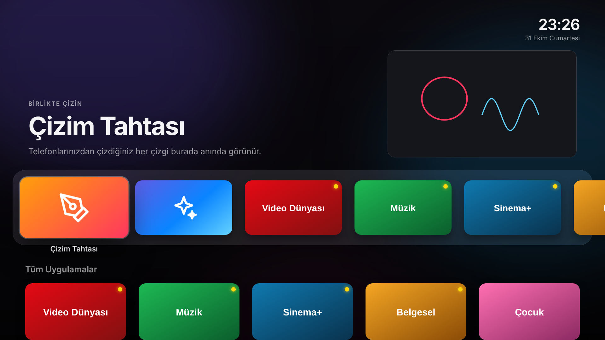
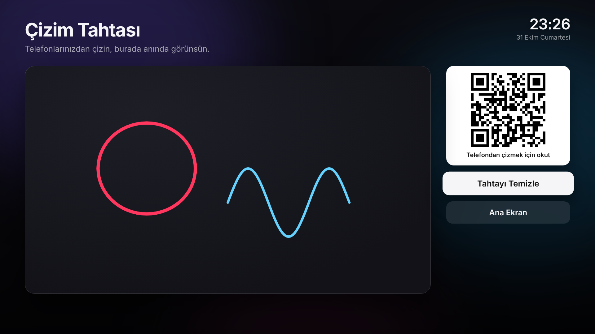
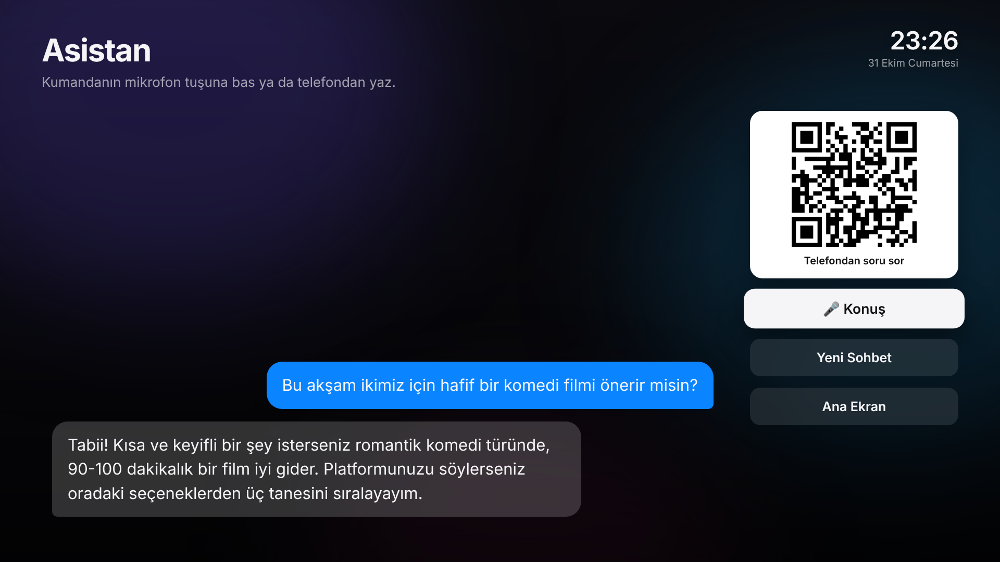
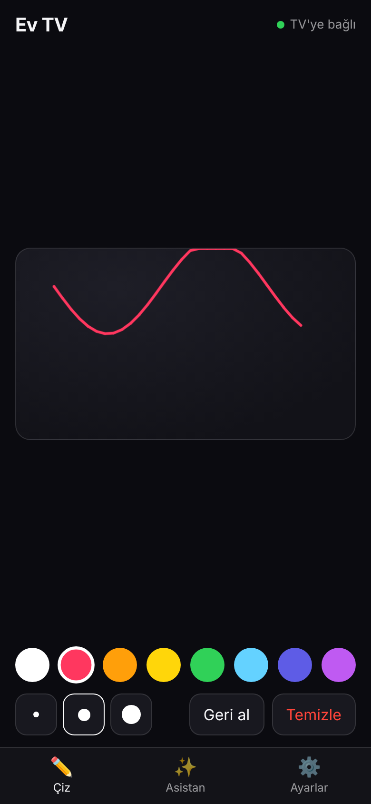

# Ev TV — Android TV kutusu için reklamsız ana ekran

**[⬇️ APK'yı indir (son sürüm)](https://github.com/kadirkaya2026/ev-tv/releases/latest/download/ev-tv.apk)**



| Çizim tahtası | Asistan | Telefon |
|---|---|---|
|  |  |  |

> Ekran görüntüleri örnek verilerle çekildi; kutunda kendi uygulamaların görünür.

Apple TV tarzı bir ana ekran. İçinde üç şey var:

- **Reklamsız ana ekran:** Yüklü uygulamalar büyük kartlar halinde, üstte cam görünümlü "favoriler" sırası, seçili uygulamanın bulanık arka planı ve saat.
- **Ortak çizim tahtası:** TV'deki QR'ı telefonla okutun. İki telefondan aynı anda çizebilirsiniz, çizimler TV'de anında görünür.
- **Claude asistanı:** Kumandanın mikrofon tuşuyla ya da telefondan soru sorulur, cevap TV'de çıkar.

İnternet sadece asistan için gerekir. Çizim tahtası ev ağında (Wi-Fi) çalışır.

## 1. APK'yı indir

[Releases](https://github.com/kadirkaya2026/ev-tv/releases/latest) sayfasından `ev-tv.apk` dosyasını indir. Giriş yapmana gerek yok; kutunun tarayıcısından ya da "Downloader" uygulamasından şu adresle de indirebilirsin:

```
https://github.com/kadirkaya2026/ev-tv/releases/latest/download/ev-tv.apk
```

## 2. TV kutusuna kur

Kolay yol, USB bellekle:
1. `ev-tv.apk` dosyasını USB belleğe kopyala ve kutuya tak.
2. Kutuda bir dosya yöneticisiyle (ör. "File Commander", "X-plore") APK'yı aç.
3. "Bilinmeyen kaynaklar" izni sorarsa o uygulamaya izin ver.

ADB ile (bilgisayardan):
```bash
# Kutuda: Ayarlar → Cihaz Tercihleri → Hakkında → "Derleme"ye 7 kez bas → Geliştirici seçenekleri → USB/Ağ hata ayıklama AÇIK
adb connect KUTU_IP_ADRESI
adb install -r ev-tv.apk
```

## 3. Ana ekran yap

- **Çoğu Android TV kutusu (ör. çoğu Çin malı kutu, Mi Box eski sürümleri):** Kurduktan sonra kumandada **Home** tuşuna bas. "Ana ekran uygulamasını seç" sorulursa **Ev TV** → **Her zaman**.
- **Soru gelmezse** (Google TV / yeni Android TV kendi ana ekranını zorlar), sistemin kendi ana ekranını ADB ile kapat:
  ```bash
  # Hangisi yüklüyse:
  adb shell pm disable-user --user 0 com.google.android.apps.tv.launcherx   # Google TV
  adb shell pm disable-user --user 0 com.google.android.tvlauncher          # Android TV
  ```
  Geri almak için aynı komutu `disable-user` yerine `enable` ile çalıştır. Hiçbir şey silinmez, sadece devre dışı kalır.

## 4. Kullanım

| Kumanda | Ne yapar |
|---|---|
| Yön tuşları | Gezin |
| OK | Aç |
| OK'a basılı tut / Menü | Uygulamayı üst sıraya ekle ya da çıkar |
| Geri | Ana ekrana dön |
| Mikrofon / Arama | Asistana sesli soru |

**Telefonu bağla:** Ana ekranda **Telefonu Bağla** kartını aç ve QR'ı okut. Telefon kutuyla aynı Wi-Fi'da olmalı. Açılan sayfada üç sekme var:
- **Çiz:** Renk ve kalınlık seç, çiz. "Geri al" sadece senin son çizgini siler.
- **Asistan:** Yaz ve gönder. Klavyedeki 🎤 ile sesli de yazabilirsin. Cevap TV'de de görünür.
- **Ayarlar:** Claude API anahtarını buraya yapıştır. Anahtarı console.anthropic.com → API Keys'ten alırsın. Anahtar sadece kutuda saklanır.

## Güvenlik notları

- Telefon sayfası rastgele bir erişim koduyla korunur. Kod QR'ın içindedir, yani QR'ı okutmayan biri bağlanamaz.
- Sunucu sadece ev ağında, 8765 portunda çalışır. Modeminde bu portu dışarı açma.
- Asistan kullanımı API hesabından ücretlendirilir (model: Claude Opus 5.5, düşük efor).

## Geliştirme

Arayüz `app/src/main/assets/web/` içinde düz HTML/CSS/JS:
- `index.html`, `tv.css`, `tv.js`: TV ekranı. Tarayıcıda `index.html#demo` ile önizleme verisiyle açılır.
- `phone.html`, `phone.css`, `phone.js`: telefon sayfası. Kutudaki sunucudan servis edilir.

Android tarafı (`app/src/main/java/com/evim/tv/`):
- `MainActivity`: WebView'i barındırır, kumanda tuşlarını arayüze iletir.
- `AppRepository`: yüklü uygulamaları listeler ve açar.
- `LocalServer`: telefon sayfası, canlı olaylar (SSE), çizim ve asistan API'si.
- `Assistant`: Claude çağrısı (anthropic-java SDK).

Derleme: `gradle assembleRelease` (Android SDK ve JDK 17 gerekir). `main`'e her push'ta GitHub Actions derler ve APK'yı Releases'e yükler. Sürüm adı `app/build.gradle` içindeki `versionName`'den gelir (ör. `1.0` → `v1.0`).

Yeni sürüm çıkarmak için `app/build.gradle`'da `versionCode`'u bir artır (kutu güncelleme olarak kursun) ve `versionName`'i değiştir (ör. `1.1`).

## Lisans

MIT
